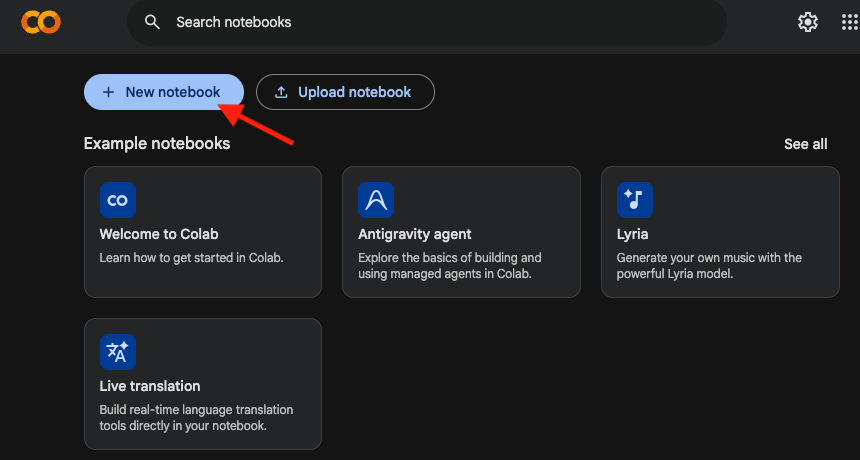
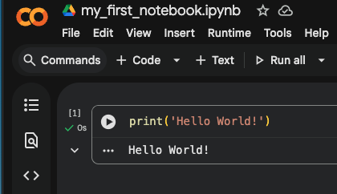
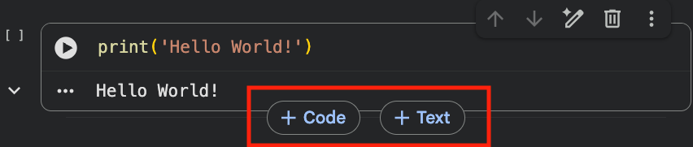
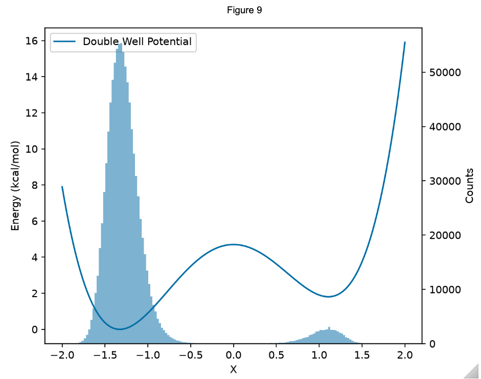

# **Intro to Python, Jupyter, and Google Colab**

## **Short Videos:**
- Watch [this](https://www.youtube.com/watch?v=fWjsdhR3z3c) video introducing how to use Python:  
- Watch [this](https://www.youtube.com/watch?v=jZ952vChhuI&t=199s) video introducing Juypter Notebooks:  
- Watch [this](https://www.youtube.com/watch?v=inN8seMm7UI) video introducing Google Colab:  

## **Colab Setup:**
#### **Step 1**
Either create a new google account or use your personal account. 
[Google](https://support.google.com/mail/answer/56256?hl=en):  
#### **Step 2**
Go to Google Colab and create a new notebook <br>
[Link to Google Colab](https://colab.research.google.com) <br>
 
#### **Step 3**
Start coding 🚀🚀🚀<br> 
<br> 

#### **Useful Features:**
<u>importing files</u><br>
<br><br>
<u>To creat new cells (code or markdown/text) hoover over the bottom of current cell</u><br>
<br>

## **Python Basics 🐍**
Python is a interpreted, high-level, general purpose programming language that is widely used in the scientific community.  
It emphasizes object-oriented programming and dynamic typing (🔋 and 😵‍💫).  
Below we will go over types, features, control flow, and semantics.

#### **Operators:**
- [Table of Operators](https://docs.python.org/3/library/operator.html)

#### **Types:**
- Float:  
  ```python
  monomer_a_energy = 1.7542
  monomer_b_energy = 0.8753
  hartree_2_kcal_mol = 627.509

  total_energy = monomer_b_energy + monomer_a_energy
  total_energy_kcal_per_mol = total_energy * hartree_2_kcal_mol

  reference_energy = 1648.8
  
  sq_error = (total_energy_kcal_per_mol -reference_energy)**2
  ```
- Integer:
  ```python 
  a = 2
  b = 3
  c_sq = a**2 - b**2

  print(c_sq*2.5)
  ``` 
- String: sequence of characters
  ```python 
  first_name = "Steven"
  last_name = "Dajnowicz"
  full_name = first_name + last_name

  print(full_name[0])
  print(full_name[1])

  is_ev_in_steven = ("ev" in first_name)
  print(is_ev_in_steven)
  ``` 
- Boolean: True (1) or False (0)
  ```python 
  print(True == 1)
  print(False == 2)

  print(1 == 2)
  ``` 
- List: a container  
  ```python 
  energies = [7.07, 8.4, 9.1]
  names = ["Bob", "Kate", "Ben"]

  names[2] = "Sam"
  names.append("Jill")

  energies.extend([6.9, 7.4, 8.8])

  print(len(energies))
  ```
- Dictionary: (key: value pair)
  ```python 
  names_and_ages = {"Bob": 43, "Kate": 37, "Ben": 45}

  age = names_and_ages["Kate"]
  print(age)

  names_and_ages["Bob"] = 44
  print(age)
  ``` 
- Set: unique values
  ```python 
  a = {1, 2, 3}
  a.add(3)
  a.add(4)
  print(a)

  b = {3, 2, 7}
  a_u_b = a.union(b)
  print(a_u_b)
  a_n_b = a.intersection(b)
  print(a_n_b)
  ```
- Function:
  ```python
  def compute_mace_energy_from_smiles(smiles: str) -> float:
      """
      compute the energy of a molecule from smile str

      :param smiles: smiles str of molecule.
      :return: MACE energy in kcal/mol.
      """
      mol_3d = convert_smiles_to_3d_mol(smiles)
      energy = compute_mace_energy(mol_3d)
      return energy
  ```
#### **Features:**
- Comments and docstring
  ```python
  
  propane = 'CCC' # hydrogens are implicit 


  def compute_mace_energy_from_smiles(smiles: str) -> float:
      """
      compute the energy of a molecule from smile str

      :param smiles: smiles str of molecule.
      :return: MACE energy in kcal/mol.
      """
      mol_3d = convert_smiles_to_3d_mol(smiles)
      energy = compute_mace_energy(mol_3d)
      return energy
  ```
- Dynamic typing 
  ```python
  
  data = "Bob"
  print(f'{data=}  |  {type(data)=}')

  data = 627.509
  print(f'{data=}  |   {type(data)=}')
  ```
- Interpreted: It executes code logic directly, line by line. C or C++ need a separate compilation step.
- Extensive Ecosystem (e.g. [numpy](https://numpy.org/), [scipy](https://scipy.org/), [scikit-learn](https://scikit-learn.org/stable/), [Biopython](https://biopython.org/), [matplotlib](https://matplotlib.org/))

#### **Control Flow:**
- if/else (conditional)
  ```python
  score = 85

  if score >= 90:
      print("Grade: A")
  elif score >= 80:
      print("Grade: B")
  elif score >= 70:
      print("Grade: C")
  elif score >= 60:
      print("Grade: D")
  else:
      print("Grade: F")

  ```
- for (iterative)
  ```python
  names = ["Bob", "Kate", "Ben"]

  for name in names:
    print(name)

  for i in range(3):
    print(names[i]) 
  ```
- while (iterative)
  ```python
  
  x = 0
  while x < 10:
    x += 1
    print(x)
  ```
- try/except (error handling)
  ```python
  new_student = "Joan"
  names_and_ages = {"Bob": 23, "Kate": 27, "Ben": 25}

  try:
      age = names_and_ages[new_student]
  except KeyError:
      print(f"{new_student} is not registered")
      # register_student(new_student). we could create a function handle this edge case
  ```
  
#### **Semantics:**
- Scope (indentation / 4 spaces)
  ```python
  names = ["Bob", "Kate", "Ben"]
  print(name)
  for name in names:
    print(name)
  print(name)
  ```
- Mutable vs Immutable 
  [Real Python Write Up](https://realpython.com/python-mutable-vs-immutable-types/#mutable-and-immutable-objects-in-python)
- References
  ```python
  a = [1, 2 ,3]
  b = a 

  a[1] = 44
  print(b)
  ``` 

#### **Useful resources**
- [Python Docs](https://docs.python.org/3/)<br>
- [Real Python](https://realpython.com/)<br>
  
## **Data  Visualization**


1) **Create a function the computes the energy of a harmonic potential and plot the energy wrt bond length**<br>
$\frac{1}{2}k(r-r_{eq})^2$
2) **load o_Cu_distance_vs_time.npz data and plot the time series and plot a histrogram of the distances**. 
  tip:
  ```python
  import numpy as np

  with np.load('o_Cu_distance_vs_time.npz') as data:
      print("Stored arrays:", data.files)
      time = data['name1'] # time is in ps
      distances = data['name2'] # distances in Angstroms

  print(f'{time=}')
  print(f'{distances=}')
  ```