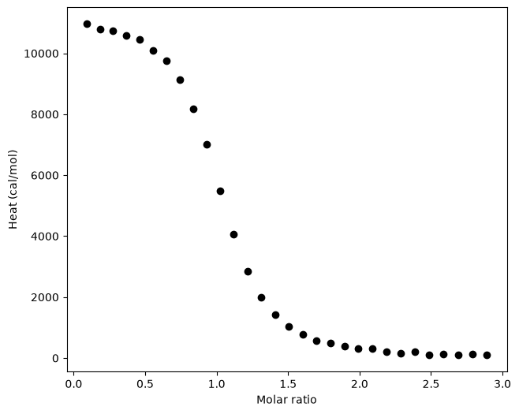
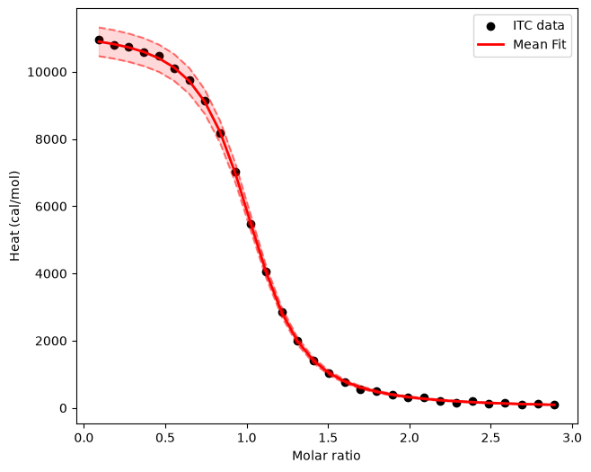

# Intro ITC
The Sample_ITC.txt file in this module contains the experimental output of the ITC experiment, please download it to a place you can easily access. The purpose of this lab is to perform a routine fitting of ITC data and interpret the estimated thermodynamic parameters acquired. We will use google colab for this exercise.

---

Open Google Colab:

```python
%pip install git+https://github.com/DajnowiczLab/itc_fit
```

pip is a standard package manager for Python. <br> 
pip install will add the third party library (itc_fit) into your Google Colab notebook. <br><br>
This will allow you import functions needed to do ITC fitting. Typically the ITC instrument along with a computer to control the instrument will have software to conduct ITC curve fitting and error analysis. However, I have refactored some code from the Gilson Lab in order for students to obtain a deeper understanding what is happening "behind the scenes".

- Import the data file `Sample_ITC.txt` in to your google colab session. 
- Import the need functions and classes need for fitting.

```python
from itc_fit.parser import parse_itc_data
from itc_fit.utils import plot, plot_raw_data, report
from itc_fit.bootstrap import run_fitting, InputData, InitialGuess

dQ, dV, cell_vol, macro_con, inject_con, mole_ratio = parse_itc_data('Sample_ITC.txt')
```
- While the experimental conditions have been parsed from the file you should inspect values of each variable (e.g. use the print function).

---

```python
input_data = InputData(dQ=dQ,
                           dV=dV,
                           temperature=298.15, # Temp in K
                           skip=0, # skip any other (other than the first) data points. 
                           cycles=1000, # Number of samples for Bootstrapping 
                           inject_con=inject_con,
                           macro_con=macro_con,
                           cell_volume=cell_vol,
                           mole_ratio=mole_ratio)
plot_raw_data(input_data, 'Sample_ITC.txt')
```
Construct an InputeData object and plot the raw data. 
Before we move on let's look the details of the [InputeData object](https://github.com/DajnowiczLab/itc_fit/blob/770a28a88a6dfb6d8e5d09fd0e8816de19780a67/src/itc_fit/bootstrap.py#L32).



---

The next step is then to simulate the fit. 

- **N** - The binding stoichiometry
- **K** - The association constant (M-1)
- **dH** - Heat change in kcal/mol 

The first step in this process is to make initial estimates for each parameter in the model equation. There are several questions to ask yourself as you estimate the possible parameters.

- **N** – Is the binding stoichiometry known? This value represents how many molecules of ligand bind to your macromolecule. This does not always directly equate to the number of binding sites of your model but provides a good estimate. It also may yield insight into any multimeric states your protein may form. It is helpful to start out with a 1:1 ratio as you play around with K and dH.
- **K** – How tightly does your molecule bind? This value could be anywhere in the range of one thousand to a billion.
- **dH** – Is this term positive or negative? The direction of your curve will tell you.

An initial guess (dH, N, and K) can be provided to the run_fitting() function. This serves as guess for the curve fitting algorithm. Does the fitting results changes if you change the sign the dH initial guess? <br>

What is the function that we are actually fitting?<br>

```python
fitting_results = run_fitting(input_data, InitialGuess(dH=1000.0))
report(input_data, fitting_results)
```
---
```
100%|██████████| 1300/1300 [00:20<00:00, 62.91it/s]Cell volume =        0.0014500 L
Cell conc. =         0.0000150 M
Injectant conc. =    0.0003986 M
Syringe error =      2.00 percent
Cell error =         2.00 percent
Heat error =         1.00 percent
Base error =         0.15 ucal
# dH =                    11.21 +/-    0.44908 kcal/mol
# K =                2300340.76 +/- 97092.76126 M^{-1}
# N =                      1.01 +/-    0.02925
# dG =                    -8.68 +/-    0.02501 kcal/mol
# TdS =                19.88974 +/-    0.44978 kcal/mol
```

---
The fitting algorithm uses bootstrapping to estimate the error.
Bootstrapping is a procedure to estimate sampling variability. 
Specifically, the fitting algorithm estimates sampling variability by performing thousands of curve-fitting iterations using a bootstrapping procedure. In each run, the algorithm takes the input cell, heat, and base errors to randomly sample heat, macro concentration, and ligand concentration values. These random samples are drawn from a normal distribution centered at the original inputs, with the input errors serving as the standard deviation.

---
Now let's plot the fitting results.

```python
plot(input_data, fitting_results, 'Sample_ITC.txt')
```


---
#### **Things to Try Out**
- Does the error in dG and dH change if you change syringe error, cell error, heat error? If so by how much?
- Are you result sensitive to the number of bootstrap cycles?
- How sensitive are the fitting result with respect to the initial guess?
  
---
#### **For Your Report**
The estimated thermodynamic parameters of the reaction are printed to the output when you call the report function. It is important to note that when you are working on your protein, these values might be significantly different. Your protein may also have more than one binding site, a negative enthalpy, or a large/small K value. There is no real way to initially approach your data other than trial and error as a result of the fitting.

Be sure to capture and retain a screenshot of your fitted values along with all the thermodynamic parameters acquired. You will be required to interpret these values and the ITC curve in your write-up. The error in the fitted data should also be discussed.